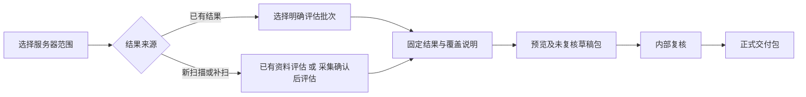

# 扫描报告中心设计

状态：Q1–Q19 已逐项确认，用户于 2026-11-24 回复“确认设计”，整体设计已接受；进入工单拆分，尚未实施。

本文定义新设计；现有功能与接口仍以 [reports.md](reports.md) 为准。术语见 [GLOSSARY.md](../GLOSSARY.md)，事实与修订关系见 [ADR005](adr/005-report-facts-and-revisions.md)。

## 定位与首期范围

基于已有评估或新扫描，针对单台、多台或当前客户对应租户的全部在管服务器，生成漏洞与生命周期综合风险报告包。管理人员阅读摘要及整改重点，运维人员查看技术依据和完整明细。（Q1–Q3）

首期主机包括物理服务器和虚拟机，纳入明确关联的软件、容器镜像；待关联资料不自动归入主机。网络设备、存储等其他设备、完整整改工单系统、独立审批角色与强制双人复核、公开分享链接不在首期范围。（Q2、Q13、Q18）

NetBox Tenant 对应客户，Device/VirtualMachine 对应主机，沿用 [ADR002](adr/002-netbox-asset-authority.md) 的身份与授权边界；在管资产和历史证据按 [ADR004](adr/004-recoverable-asset-deletion.md) 区分。

## 页面与操作流程

首页提供“新建报告”和“报告历史”，常用操作围绕主机名称及状态展开，评估编号、版本、哈希放入依据详情。（Q14）

| 位置 | 内容与主要操作 |
| --- | --- |
| 首页 | 新建报告；按名称、范围、生成时间及状态识别历史报告 |
| 第一步：服务器范围 | 单台、多选、租户全部；展示服务器清单和主数据同步时间 |
| 第二步：结果来源 | 使用已有结果、重新扫描、只补扫缺失或过期项；新扫描可选择先更新采集资料 |
| 第三步：覆盖检查 | 对应资料、结果时间、覆盖及失败/缺失/陈旧情况；允许明确指定历史批次 |
| 第四步：报告配置 | 综合或专题、可选章节、比较基准、新鲜度期限、PDF 明细方式、分报告和证据附件 |
| 第五步：创建任务 | 确认范围及配置，固定服务器清单，进入任务详情 |
| 任务详情 | 分项进度、等待资料/确认、失败原因、重试、取消、结束等待并生成含缺口草稿 |
| 报告详情 | 预览、覆盖和来源、修订/复核记录、逐格式状态、草稿和正式包下载 |



## 范围、资料与结果

### 固定时点

创建任务时固定服务器清单。开始时有 100 台，期间新增的 2 台不自动加入本次范围。最终报告结果集固定所用资料版本、评估及主机关联和覆盖说明；后续主数据同步、采集、扫描不改变旧报告。（Q6）

没有结果的范围内主机仍列出。执行新操作时重新检查授权和目标有效性，失效目标停止后续采集并披露原因；历史报告保留，访问仍受客户授权限制。（Q2、Q18）

### 已有结果选择

默认选择每个对象当前资料版本下最近一次成功评估，生成前展示对应资料、时间与缺口。当前采纳新版资料但只有旧版评估时，不自动用旧结果代表当前状态；历史批次由用户明确选择。最近一次扫描失败时，即使另有成功结果，也显示失败情况。最终使用明确批次，不能将“最近成功”解释为完整覆盖。（Q4）

### 新扫描与补扫

| 方式 | 行为 |
| --- | --- |
| 已有资料重新评估 | 默认路径，基于已确认资料的明确版本执行已接入能力 |
| 重新采集后评估 | 沿用采集确认流程，确认后才扫描；脚本上传保持等待资料 |
| 只补扫缺失或过期项 | 保留可用且未过期结果，对所需项执行相应采集或评估路径 |

基础采集不自动涵盖全部应用依赖及容器组件；只执行已有能力，缺少条件或不支持的范围明确说明。（Q5、Q10）

采集资料与漏洞评估分别检查新鲜度，默认超过 7 天提醒，期限可修改。过期先提醒，允许明确采用并披露；重新评估不会刷新采集时间。生命周期资料按来源及适用性判断，不套用 7 天期限。报告保留检查时点、配置和资料时间，历史呈现不随查看日期漂移。（Q10）

## 任务、失败与恢复

任务后台持久保存，关闭页面继续执行，返回后可查看。执行状态、报告复核状态与文件生成状态分别呈现。（Q15、Q17）

| 场景 | 处理 |
| --- | --- |
| 部分成功 | 允许生成，明确风险统计仅来自已取得结果的范围，列出全部失败、等待、未评估主机 |
| 全无可用结果 | 只生成执行与覆盖说明，不给出整体风险结论 |
| 等待上传或确认 | 保存等待项；可继续提供资料，或明确结束等待并生成含缺口草稿 |
| 单项失败 | 可以单独重试，保留成功结果与失败记录 |
| 用户取消 | 停止后续执行，保留已有结果，显示已完成、取消和未完成范围 |
| 服务重启中断 | 执行中断明确标记，由用户重试未完成项，避免自动重复采集或扫描；已保存等待项保留 |
| 补扫完成 | 本次结果尚未固定时可纳入选择；已有报告后，选择新结果形成关联原报告的新报告 |

100 台中 80 台有结果、20 台失败，报告范围仍为 100 台；另外 20 台不能算作零漏洞或已通过。（Q9、Q15）

## 报告正文

| 章节 | 内容 |
| --- | --- |
| 封面 | 客户、名称、编号、扫描/生成时间、修订及交付状态 |
| 管理摘要 | 主要风险、重点服务器、优先处理事项 |
| 扫描范围与覆盖 | 全部目标、成功/失败/等待/未评估、方式、资料时间、工具/规则/库信息与限制 |
| 风险总览 | 漏洞数量、严重程度、涉及主机及确认影响；生命周期风险独立汇总 |
| 服务器明细 | 主机身份、IP、系统、关联软件/镜像、所用结果与分项风险 |
| 漏洞技术明细 | 标识、组件/位置、当前版本、严重程度及评分来源、适用性、检测及修复依据 |
| 生命周期风险 | 系统/设备支持、维保等已接入期限风险；来源、不适用与未知 |
| 整改建议 | 优先级、动作、关联对象、依据及复测方式 |
| 历史对比 | 可选；明确基准与可比范围的问题及覆盖变化 |
| 证据附录 | 来源、统计口径、结果及原文索引、工具/规则版本与校验信息 |

综合报告覆盖漏洞与生命周期；允许专题及关闭可选章节，范围、覆盖和未知说明始终保留。原始证据附件按需选取。（Q7）

### 统计口径

- 漏洞去重数、发现实例数、涉及服务器数、确认受影响服务器数分开；CVE 和其他漏洞标识保持区分。
- 同一镜像的一条发现关联三台主机，镜像发现计一次、涉及主机计三台；总报告不通过累加主机分报告重复计算共享发现。
- 工具匹配或镜像关联不自动代表主机确认受影响，未知和仅有工具匹配的发现不计入确认影响。
- 漏洞与生命周期分别统计，保留严重程度来源及未知状态，不使用混合相加的总风险分。
- 无可用结果不显示为零漏洞；部分结果显示实际统计范围及缺口。

以上遵循 Q11 和既有事实契约。

### 历史比较与整改

用户明确选择历史报告作基准，在可比范围展示新增、持续、变化、本次未再观察到的问题；资产范围、资料版本和扫描能力变化单列。上次 100 台、本次 80 台，缺失 20 台不能计为漏洞消失；未再观察到不直接标为已修复。（Q12）

整改依据扫描结果和带来源的修复资料，按严重程度、确认影响与业务重要性组织优先级。缺失业务重要性保持未知，缺乏修复依据标为待核实，不编造补丁或版本。AI 可辅助摘要及解释，失败保留固定模板，遵守现有事实与证据保护。首期输出可分派明细表，不新增完整工单系统。（Q13）

## 修订、复核与权限

1. 固定结果后可以预览、下载带“未复核”标识的草稿包。
2. 沿用草稿、待复核、已通过、已交付流程；自动生成不自动通过复核。
3. 同一报告各修订共享固定事实，调整摘要、段落、章节和呈现产生新修订并重新复核。
4. 补扫或替换结果改变事实时，形成关联原报告的新报告，旧报告及交付保留。
5. 正式包绑定已复核的明确修订，各格式引用同一事实集，保留复核和交付记录。

首期沿用当前客户授权操作员，允许同一人生成并复核，保留操作人与时间；不宣称独立审批角色或双人隔离，不提供公开分享链接。（Q8、Q16、Q18）

## 文件与完整性

默认 ZIP 包含总报告 PDF、离线 HTML、扫描与整改明细表（XLSX）；主机分报告与原始扫描证据可选。文件清单核对所选产物、修订与校验值。（Q3、Q17）

```text
客户名称_扫描报告_日期.zip
├── 扫描总报告.pdf
├── 扫描总报告.html
├── 扫描与整改明细.xlsx
├── 服务器分报告/          # 可选
├── 原始扫描证据/          # 可选
└── 文件清单及校验值.json
```

PDF 默认突出摘要、服务器风险及重点漏洞，说明筛选规则和未展开数量；HTML 与明细表保留完整发现。可选择包含全部明细的 PDF。页面分页不影响完整导出，两万条发现不能因摘要或分页而从完整附件消失。（Q19）

各格式独立显示状态，只重试失败格式，保留成功产物。允许明确下载可用部分，不能标为完整包。默认必选文件及勾选附件全部成功才显示完整；附件失败可重试或明确取消选择，不静默遗漏、不重新扫描，最终清单反映实际选择。（Q17）

包完整性与扫描覆盖分开：100 台中 80 台有结果可以生成文件齐全的报告包，但覆盖仍为部分，报告继续披露其余 20 台。（Q9、Q17）

## 验收场景

| 场景 | 应观察到的结果 |
| --- | --- |
| 单台、多台、租户全部 | 明确客户及主机清单，同名对象不合并，待关联资料不计入主机 |
| 超过现有最近 100 次/20 个引用限制 | 完整查询并处理范围，不因当前候选及引用上限漏掉主机 |
| 新资料只有旧扫描 | 默认提示缺少匹配结果，采用历史批次需明确选择 |
| 旧资料今天重评估 | 评估时间更新，采集陈旧提醒仍存在 |
| 执行期间新增服务器 | 原清单不扩张，下一份报告才纳入 |
| 重新采集或脚本上传 | 先取得资料及确认，再评估明确输入，不冒充自动能力 |
| 80 台成功、20 台失败 | 列出全部 100 台及缺口，仅统计可用结果 |
| 全无可用结果 | 仅执行及覆盖说明，无整体风险结论 |
| 共享镜像关联三台主机 | 发现计一次、涉及主机列三台，确认影响依证据 |
| 历史比较范围减少 | 缺失主机单列，不判为已修复 |
| 关闭页面、服务中断、取消 | 可恢复查看，等待项保留；中断由用户重试，取消停止后续执行 |
| 调整文字与补扫 | 前者新修订并重新复核，后者新报告，旧交付不变 |
| AI 不可用 | 固定模板仍可生成，证据及未知说明不丢失 |
| PDF 或附件失败 | 成功文件保留，仅重试失败产物，未齐全不显示完整 |
| 两万条发现 | 摘要披露筛选，完整 HTML/明细表保留全部，完整 PDF 可选 |
| 授权或目标失效 | 后续新操作停止或拒绝；历史保留不等于持续授权 |

## 决定索引与设计树

四轮用户分别确认“三个都按建议”“Q4–Q8 都按建议”“Q9–Q13 都按建议”“Q14–Q19 都按建议”。

| 分支 | 已接受决定 |
| --- | --- |
| 定位与内容 | Q1 综合风险 → Q7 十章及专题 → Q11 分离统计、Q12 可比历史、Q13 有依据整改、Q19 摘要及完整明细 |
| 范围与执行 | Q2 主机范围 → Q4 明确结果、Q5 扫描输入、Q6 固定时点 → Q9 部分失败、Q10 新鲜度/补扫、Q15 任务恢复 |
| 交付与操作 | Q3 报告包 → Q8 草稿及复核 → Q14 页面流程、Q16 新报告/修订、Q17 文件状态、Q18 权限 |

产品设计树已逐项收敛，用户已整体确认，当前进入工单拆分。接口字段、队列/存储实现、文件转换依赖等工程选择在实施方案中确定，不属于已完成的功能。

## 现有接缝与参考

现有报告已具备评估快照、固定事实、来源哈希、受控修订、复核及正式 HTML；需扩展主机范围解析、完整候选查询、批量编排、等待/恢复、草稿包及 PDF/XLSX/ZIP 输出。保留 [reports.md](reports.md) 的事实和授权保护，不将局部候选当作全租户范围。

- [主机配置与资料关联](collection-hierarchy-design.md)：明确主机/软件/镜像关系，采集与评估分离。
- [Tenable 创建扫描报告](https://docs.tenable.com/nessus/10_10/Content/CreateAScanReport.htm)：范围、模板及格式。
- [Tenable 扫描摘要](https://docs.tenable.com/nessus/Content/ViewScanSummary.htm)：时间、配置、严重程度与覆盖。
- [Greenbone 报告与漏洞管理](https://docs.greenbone.net/GSM-Manual/gos-25.0/en/reports.html)：摘要、技术结果、检测可信度、修复类型与差异报告。
