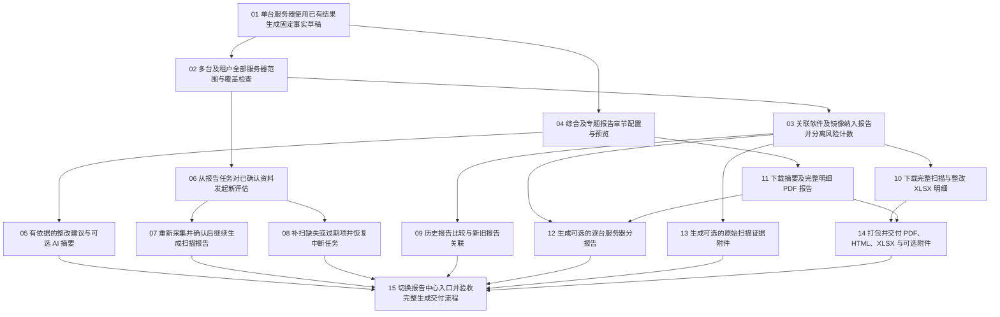

# 扫描报告中心：工单拆分草案

2026-11-24。状态：用户调用 implement 接受拆分并进入实施；已发布规格 #65 和子工单 #66–#80，原生子任务及阻塞关系已核对。

设计依据：[扫描报告中心设计](../../scan-report-center-design.md)。术语与 ADR 沿用已确认设计，不重复建设现有采集、评估、内部复核及固定事实能力。

## 发布目标

配置的工单系统为 niwaip/ys GitHub Issues。已创建[规格 #65](https://github.com/niwaip/ys/issues/65)及 15 个 ready-for-agent 子工单，建立原生 sub-issue 与 blocking 关系。发布身份映射见 published.json。当前对话没有指定既有规格作为父工单；不修改或关闭其他现有规格及工单。

当前仓库有些既有功能对应的旧工单仍为 OPEN，不能仅凭工单未关闭将已实现功能重新作为本轮阻塞。实现过程沿用项目现有集成分支及 PR 约定，生产部署不包含在本轮工单交付内。

## 拆分与阻塞

每项必须交付可独立操作、持久保存并经公开 API 和真实浏览器验证的行为。持久化、API、界面和验证随行为一起完成；不拆为数据库、后端、前端等横向阶段。没有发现必须单独先做的全仓机械重构；必要整理并入 01 的完整闭环。

| 编号 | 工单 | 真正阻塞项 |
| --- | --- | --- |
| 01 | [单台服务器使用已有结果生成固定事实草稿](01-single-host-existing-results.md) | 无 |
| 02 | [多台及租户全部服务器范围与覆盖检查](02-multi-host-tenant-scope.md) | 01 |
| 03 | [关联软件及镜像纳入报告并分离风险计数](03-linked-software-images-statistics.md) | 02 |
| 04 | [综合及专题报告章节配置与预览](04-report-templates-sections.md) | 01 |
| 05 | [有依据的整改建议与可选 AI 摘要](05-evidence-based-remediation.md) | 04 |
| 06 | [从报告任务对已确认资料发起新评估](06-scan-confirmed-inputs.md) | 02 |
| 07 | [重新采集并确认后继续生成扫描报告](07-collect-confirm-assess.md) | 06 |
| 08 | [补扫缺失或过期项并恢复中断任务](08-retry-cancel-incremental-scan.md) | 06 |
| 09 | [历史报告比较与新旧报告关联](09-compare-linked-reports.md) | 03 |
| 10 | [下载完整扫描与整改 XLSX 明细](10-complete-xlsx-export.md) | 03 |
| 11 | [下载摘要及完整明细 PDF 报告](11-summary-full-pdf-export.md) | 04 |
| 12 | [生成可选的逐台服务器分报告](12-per-host-report-attachments.md) | 03、11 |
| 13 | [生成可选的原始扫描证据附件](13-verified-evidence-attachments.md) | 03 |
| 14 | [打包并交付 PDF、HTML、XLSX 与可选附件](14-complete-delivery-package.md) | 10、11 |
| 15 | [切换报告中心入口并验收完整生成交付流程](15-report-center-navigation-workflow.md) | 05、07、08、09、12、13、14 |

## 依赖图

## 为什么不增加其他阻塞

- 04 章节模板和 11 PDF 可先针对 01 的单台固定报告完成；不必等待批量范围、新扫描或共享镜像汇总。
- 06 新评估复用已有资料，不依赖 07 重新采集。07 与 08 在 06 之后各自交付采集确认路径和补扫/恢复路径，最终入口同时接入。
- 09 比较已有报告，不依赖先发起新扫描；新扫描得到的结果最终使用相同比较机制。
- 10 导出已有结果和已有整改依据，不必等待 05 的可选 AI 与受控整改扩展。
- 14 先交付默认 PDF/HTML/XLSX 包，按通用产物选择接入可选附件；12、13 的缺席不阻止默认包独立完成。
- 15 必须等待所有最终叶子功能；每个前置工单自身已有公开 API 与浏览器闭环，不能把此前欠缺的联调或验证推给 15。

## 设计覆盖

| 已确认决定 | 主要工单 |
| --- | --- |
| Q1 综合报告定位 | 04、05、15 |
| Q2 主机范围及关联资料 | 01、02、03 |
| Q3 默认报告包和可选附件 | 10、11、12、13、14 |
| Q4 已有结果明确选择 | 01、02、03 |
| Q5 重新评估或采集后评估 | 06、07 |
| Q6 固定范围和结果 | 01、02、06 |
| Q7 章节和专题 | 04、09 |
| Q8 草稿、复核与正式交付 | 01、04、10、11、14 |
| Q9 部分失败和全无结果 | 01、02、06、07、08 |
| Q10 新鲜度和补扫 | 02、07、08 |
| Q11 统计及共享对象去重 | 03、09、10 |
| Q12 历史比较 | 09 |
| Q13 有依据整改和可选 AI | 05、10 |
| Q14 五步流程及历史/详情 | 01、02、15 |
| Q15 后台持久化、等待、取消和中断 | 06、07、08 |
| Q16 新报告与修订 | 01、04、06、08、09 |
| Q17 逐文件失败、重试及完整性 | 10、11、12、13、14 |
| Q18 客户授权与同人复核 | 所有工单，尤其 01、06、13、14、15 |
| Q19 摘要 PDF 及完整明细 | 10、11、15 |

## 审阅问题

- 粒度是否合适，是否有过粗或过细的工单？
- 是否仅保留真正阻塞开始实施的依赖？
- 是否需要合并或继续拆分？

用户已通过 implement 调用接受推荐拆分。各文件保留本地编号用于阅读，GitHub 已建立真实 issue 身份及原生 blocking 关系；本轮不关闭既有工单。

